# Mohamed Benboubaker — E-commerce, ERP & Marketplace Integration

Full Stack Developer (PHP 8 · Shopify · Dolibarr ERP · REST/SOAP · Java 11) based in Tunisia, open to remote or on-site roles.
📧 medbenboubaker1995@gmail.com · 📞 +216 54 396 186

> This repository is a **portfolio showcase**. The production code belongs to the companies I work for, so it only contains
> architecture notes, masked screenshots and **cleaned code samples** (no credentials, customer data or company-specific values).

---

## What I build

| Area | Highlights |
|---|---|
| **Shopify stores** | Several stores in production for the FR / EU market — custom Online Store 2.0 themes in **Liquid**, sections & blocks, metafield-driven specification tables, Admin API (REST/GraphQL) automation, Google Merchant Center feeds |
| **ERP integration** | **Shopify ⇄ Dolibarr ERP** sync of orders, products, customers and real-time stock (PHP 8 microservices, webhooks, CRON, Blue/Green deploys) |
| **Marketplaces** | Dolibarr connected to **Amazon (SP-API)**, **Leroy Merlin / Castorama (Mirakl API)**, ManoMano, Rakuten — catalogue & offer feeds, CSV/XML mapping, GS1 EAN codes, stock and price sync |
| **Logistics** | Fulfilment providers (CIRRO, Octopia), carriers (Chronopost, GLS, Heppner) with automatic tracking-number retrieval |
| **Custom Dolibarr modules** | Multi-carrier **order preparation**, **marketplace pricing & margins** with offer-expiry alerts, **catalogue push** to Mirakl, **internal delivery** with driver mobile page and signed proof of delivery |
| **Mobile** | Android warehouse app — inbound/outbound scanning, real-time stock through the Dolibarr REST API |
| **Earlier** | Java 11 services integrated with SAP (TIBCO) and Windchill PLM (SOAP/WSDL); WordPress / WooCommerce sites (Stripe, PayPal); PrestaShop stores |

Daily use of AI coding agents (Claude Code) for coding, testing and documentation — always reviewed before production.

## Architecture

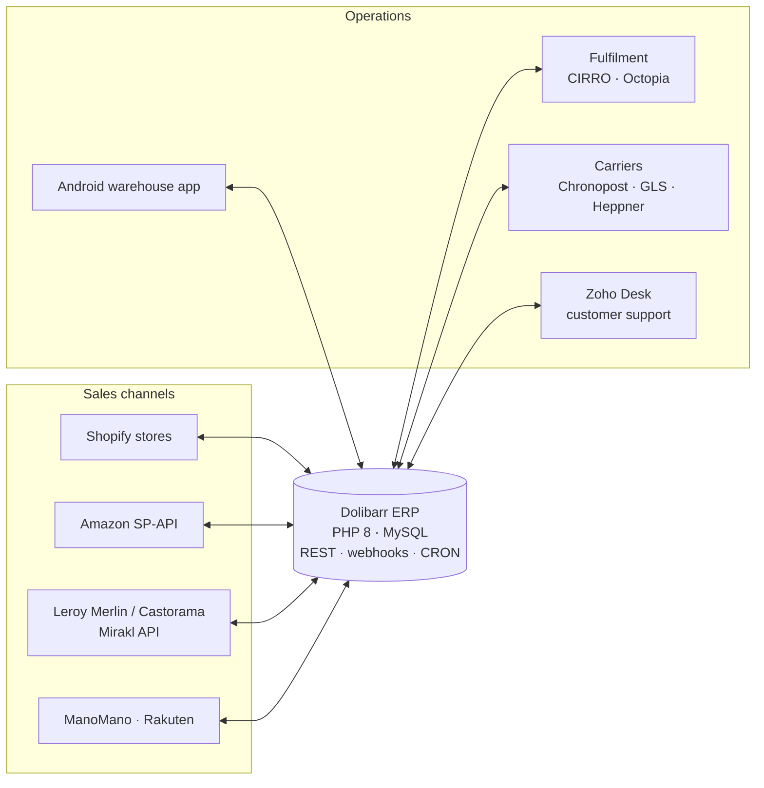

More detail: [docs/architecture.md](docs/architecture.md)

## Screenshots

### Shopify stores (live)
| | |
|---|---|
| 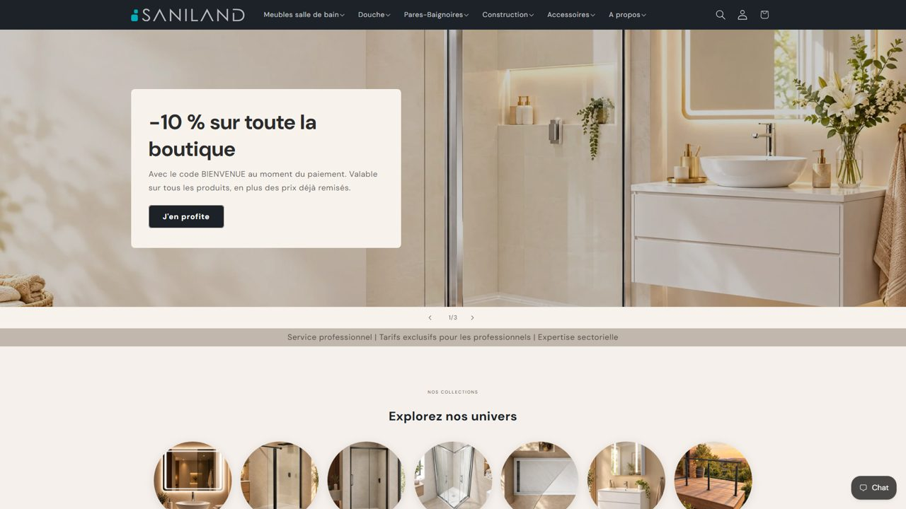 | 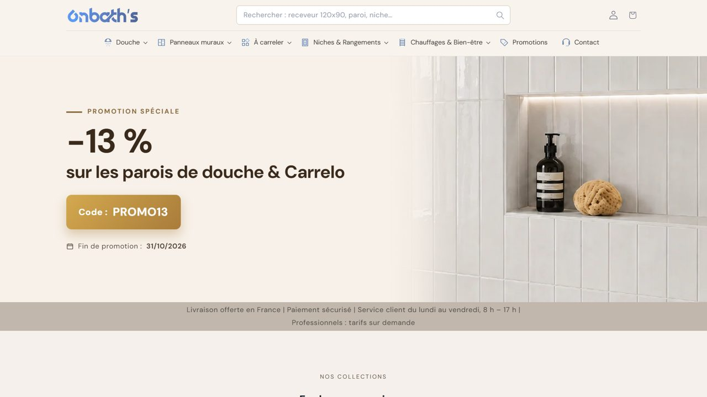 |
| 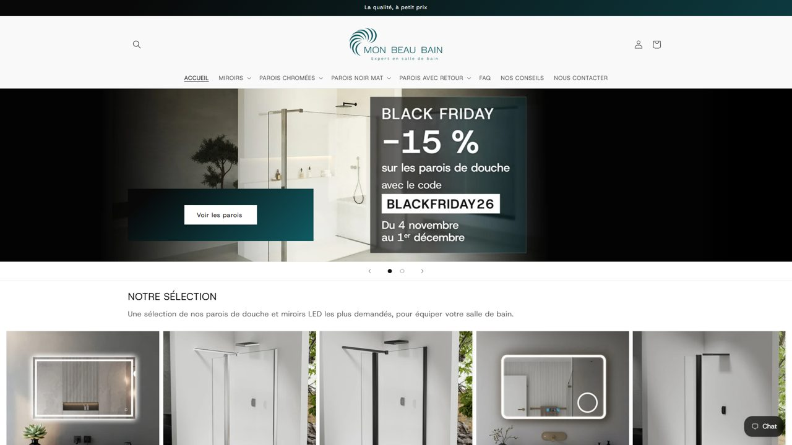 | 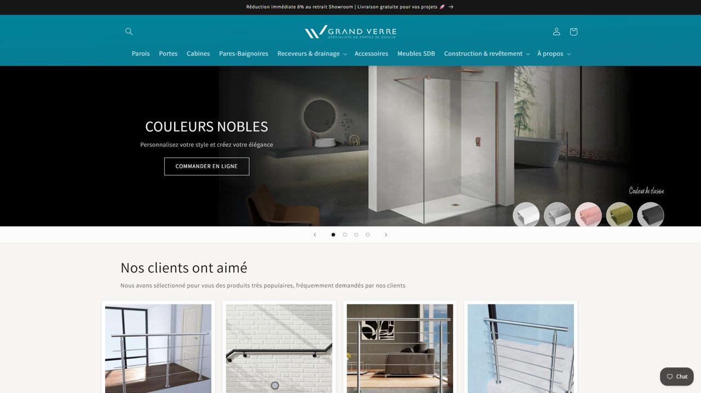 |

Product page — variants, stock and a specification block generated from metafields:

| | |
|---|---|
| 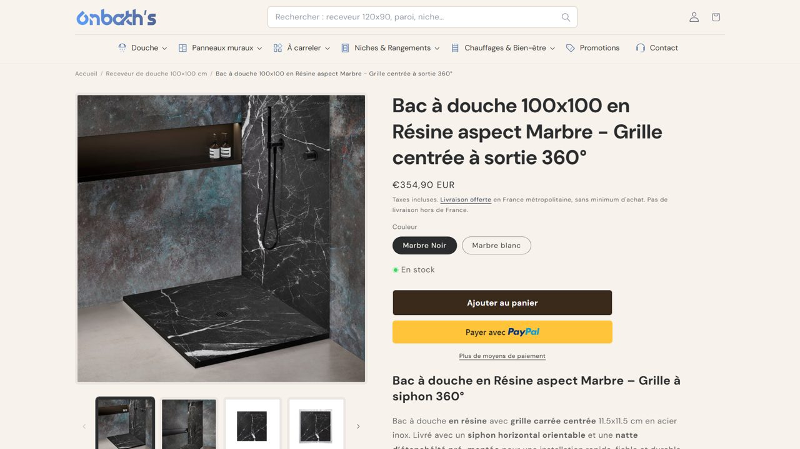 | 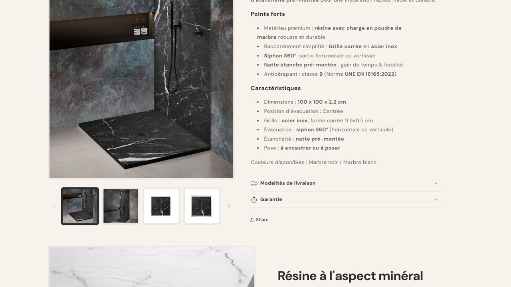 |

### Custom Dolibarr modules (customer data, prices and margins are blurred)
| | |
|---|---|
| 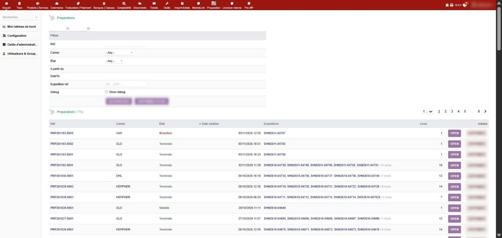 | 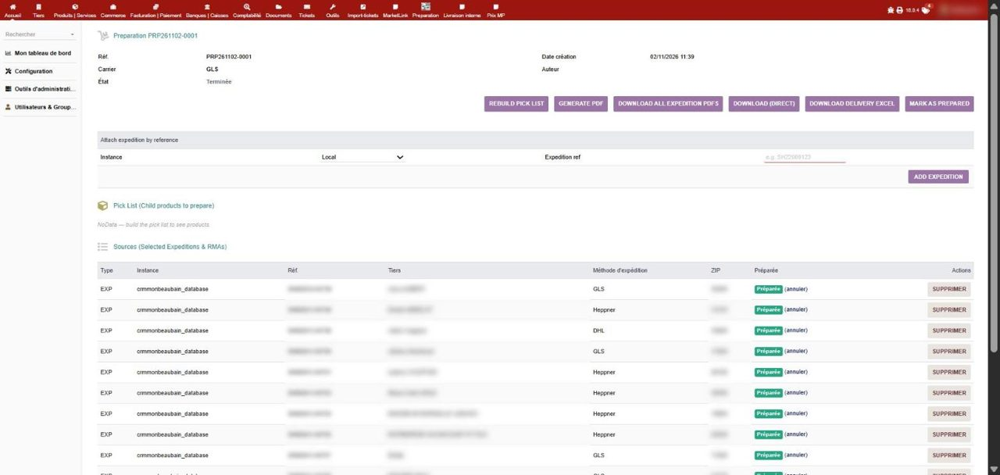 |
| 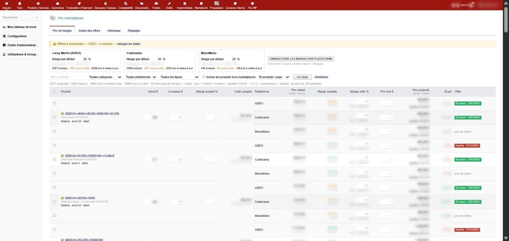 | 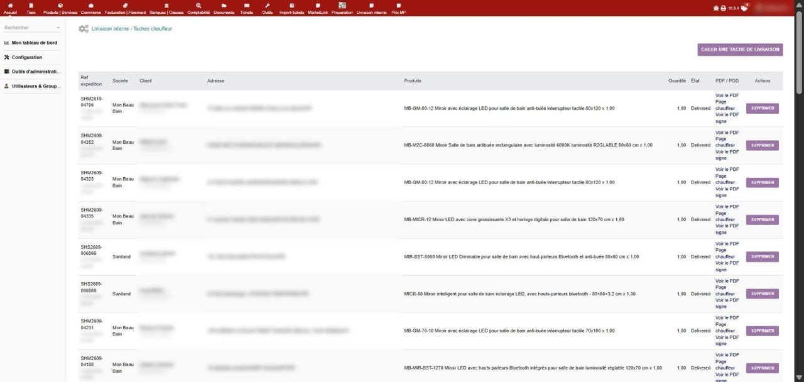 |

## Code samples

| Sample | Description |
|---|---|
| [`samples/amazon-stock-sync`](samples/amazon-stock-sync) | Recurring **Dolibarr → Amazon** stock sync through the Selling Partner API: LWA token, open-listings report polling, 40-char kit-SKU mapping, JSON_LISTINGS_FEED PATCH messages, async feed result logging, dry-run mode, credentials kept outside the web root |
| [`samples/marketplace-push-tool`](samples/marketplace-push-tool) | Design of a Dolibarr admin tool that audits and pushes missing product attributes to a **Mirakl** marketplace without ever erasing existing data |

## Stack

`PHP 8` `MySQL / MariaDB` `JavaScript` `Liquid` `Java 11` `SQL` · `REST` `GraphQL` `SOAP/WSDL` `Webhooks` `CRON` · `Shopify` `Dolibarr` `WordPress` `WooCommerce` `PrestaShop` · `Amazon SP-API` `Mirakl` · `Git` `Blue/Green deploy` `Claude Code`

## Education
- Master's in Digital Management — ESSECT, Tunis (2020)
- Bachelor's in Business Computing — ESSECT, Tunis (2018)

---

### 🇫🇷 En bref
Développeur Full Stack (PHP 8, Shopify, Dolibarr ERP, intégrations marketplaces) basé en Tunisie, disponible en télétravail ou sur site.
Ce dépôt présente mes réalisations : boutiques Shopify, synchronisation Shopify ⇄ Dolibarr, connecteurs Amazon / Mirakl / transporteurs,
modules Dolibarr sur mesure — avec captures (données clients masquées) et exemples de code nettoyés.
